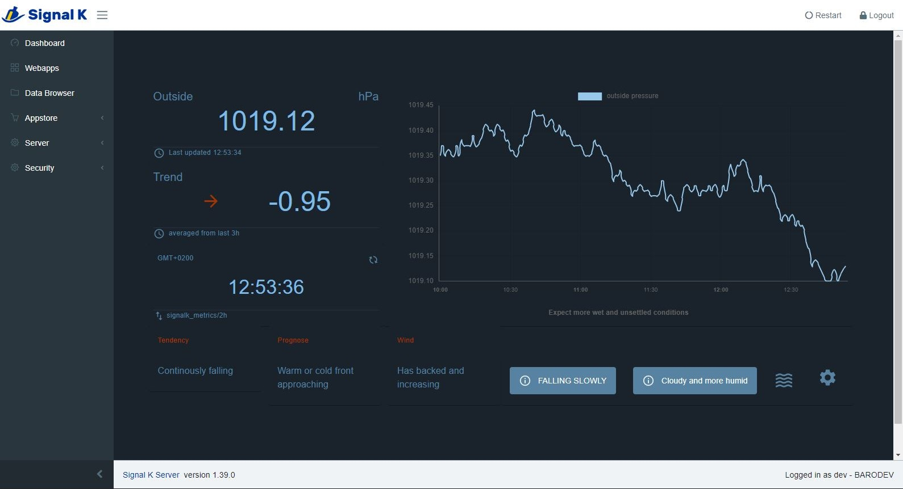
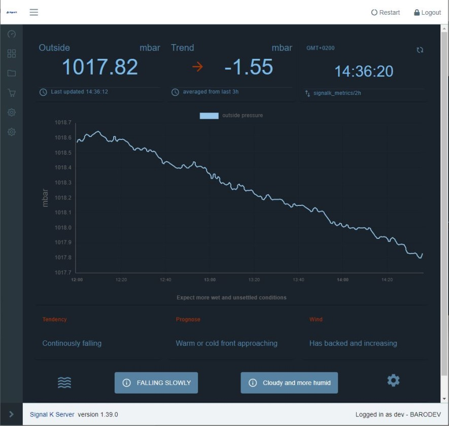
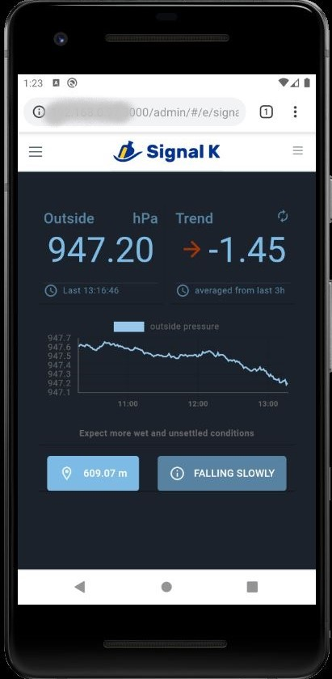
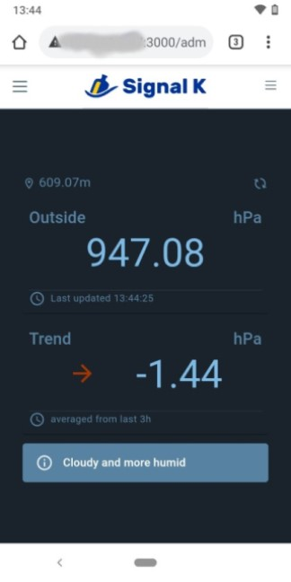
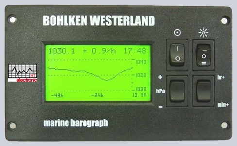
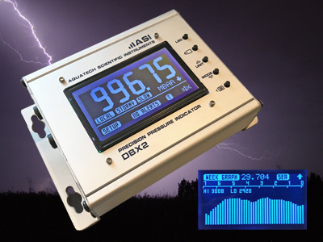

# signalk-barograph-plugin

SignalK Server plugin to record and visualize environmental data

## Install & Use

### Prerequisites

> **SignalK Server 2.24 or later** is required - the barograph app is built for the React 19 admin UI introduced with 2.24.
> On SignalK Server **before 2.31** only **administrators** can view the barograph history: plugin endpoints are admin only on these versions; 2.31 and later open them to every logged-in user (read only).

In order for this plugin to work you need to have InfluxDB available and configured - by using the latest __[JS client](https://influxdata.github.io/influxdb-client-js/influxdb-client.html)__ v2 API, the plugin supports both OSS version 1.8.4+ (32bit) and 2.0.x (64bit). Implementation may be in the same local network as SignalK server, hosted on docker or in the cloud.
- InfluxDB v1.8 (no organisation configured): the barograph history is queried with InfluxQL
- InfluxDB v2.x: the barograph history is queried with Flux

### Install

Install the plugin from the SignalK Server appstore and configure as outline below. Post installation 'Activate' on the SignalK Plugin Config interface and enter your influx connection:

| Configuration | Influx v1.8.x | Influx OSS v2.x |
| ------------- | ------------- | --------------- |
| URI           | http(s)://url:port | http(s)://url:port |
| Token         | username:password | token       |
| Organisation  | empty         | required        |
| Bucket        | database/retentionpolicy | bucket          |

It is advised to have a default or explicit retention policy configured of at least 3h, better 6h.
*Note: Pointing to influxDB as http://localhost:8086 caused unreliable connection issues during test - you may want to use a fixed ip address instead.*

The InfluxDB credentials stay on the server: the embedded barograph app reads its configuration and the pressure history from the plugin endpoints (see [Barograph App](#barograph-app)) - the former *selfRef* connection string (SignalK user and password) is no longer needed.

If InfluxDB is not reachable when the plugin starts, the plugin state shows the reason and the barometer predictions continue without it. Data points that cannot be written are cached in the plugin data directory (up to 100 MB / 30 days) and replayed once InfluxDB accepts writes again; a filling cache is raised on the plugin state.

Use the write interval to configure data points **upload** interval to influx in seconds - read frequency is dependent on the path configuration (but will not below 1s) outlined in the next section.

### Sensor Configuration

This plugin focuses on capturing environmental data using influx - it is not intended to and will not record other data points (likewise navigation, performance, propulsion, electrical, etc.) despite the configuration supports any appropriately configured SignalK path. For more similarily specialized plugins see [tbd]. On plugin start a configuration file will be created in the plugin data directory which can be tailored to the sensors installed and configured. It has been tested with 
- __[signalk-raspberry-pi-bme280](https://www.npmjs.com/package/signalk-raspberry-pi-bme280)__
- __[Signal K Node server RuuviTag plugin](https://www.npmjs.com/package/signalk-ruuvitag-plugin)__

It is advised to have all paths connfigured underneith `environment` in a similar fashion in order to allow influx to automically create appropriate tags. In case path config isn't configurable, you can potentially re-config the path using the `config` attribute, eg.

| Path received from RUUVI-Tag | Path to be used for formatting points |
| ------------- | --------------- |
| `environment.outside.relativeHumidity` | `environment.outside.humidity` | 

### Paths Configuration
In order for the plugin, the app and predictions to work at a minimum the following four paths shall be present:

`{"path":"environment.outside.pressure","period":60000,"policy":"instant","minPeriod":30000,"trend":"pressure"}`

`{"path":"environment.outside.temperature","period":60000,"policy":"instant","minPeriod":30000,"trend":"temperature"}`

`{"path":"navigation.gnss.antennaAltitude","period":900000,"policy":"instant","minPeriod":30000,"trend":"altitude"}`

`{"path":"navigation.position","policy":"instant","trend":"position"}`

Additional paths can be configured in order to make more environmental data available in influx for analysis and visualization, eg.

`{"path":"environment.forecast.time","period":10000,"policy":"fixed"}`

`{"path":"environment.forecast.time.sunrise","period":900000,"policy":"fixed","convert":"dt|>influx"}`

`{"path":"environment.forecast.time.sunset","period":900000,"policy":"fixed","convert":"dt|>influx"}`

`{"path":"environment.inside.humidity","period":60000,"policy":"instant","minPeriod":30000}`

`{"path":"environment.outside.relativeHumidity","period":60000,"policy":"instant","minPeriod":30000,"config":"relativeHumidity|>humidity"}`

`{"path":"environment.forecast.humidity","period":900000,"policy":"fixed"}`

## Barograph App

The barograph is embedded in the SignalK admin UI (*Webapps → Barograph*): a barometer dial with the current pressure and a set hand at the start of the trend period, the barograph trace for 3h, 12h, 24h, 48h or 72h, the trend and the predictions. Unit (hPa, mbar, kPa, inHg, mmHg, atm, Pa), sea level reduction and trace smoothing are set per browser.

Up to the *Write Bucket Retention* the history is read from the write bucket, beyond it from the read bucket (field `average`, e.g. downsampled by an InfluxDB task) - without a separate read bucket the write bucket is used for every timescale.

**Forecast trace** - with the [Open-Meteo plugin](https://github.com/inspired-technologies/signalk-openmeteo-plugin) (`openmeteo-signalk`) installed and enabled, the barograph shows its pressure forecast as a second, dashed trace: the forecasts captured at the time and position from InfluxDB (`environment.forecast.pressure`, stored at the time they are valid for, of the first Open-Meteo model only) and the next 3 hours from the forecast endpoint of the Open-Meteo plugin. Both apply to the station elevation (`navigation.gnss.antennaAltitude`), like the barometer. The trace is switched off with *Forecast trace* in the plugin configuration and is inactive without the Open-Meteo plugin.

| Endpoint | Description |
| -------- | ----------- |
| `GET /plugins/signalk-barograph/settings` | subscribed paths, history availability and timescales - no credentials |
| `GET /plugins/signalk-barograph/history?hours=3` | pressure history in Pa as `[[time ms, Pa], ...]`, averaged to about 720 points (one minute up to 12h, read bucket not below 5 minutes) |
| `GET /plugins/signalk-barograph/history?hours=3&series=forecast&source=<$source>` | pressure forecasts of one source as captured at the time |

Both are described in the admin UI under *Documentation → OpenAPI*.

## Screen Samples

A working example of a full configuration file can be found __[here](./samples/pathconfig.json)__.

The embedded web app will try to adjust to available screen estate as much as possible:

| Main Screen | Mobile | Small |
| ------------- | ------------- | --------------- |
|  |  |  |

## Inspiration

The application is inspired by marine industry products like the __[Bohlken High Precision Barograph](http://www.bohlken.net/bg/bg1512_en.htm)__ or __[ASI Precision Digital Instruments DBX2](https://www.digitalbarograph.com/)__ by AquaTech Scientific Instruments. 

| Bohlken Westerland | ASI DBX2 | 
| ------------- | ------------- | 
|  |  |

## Details on Input, Predictions & Output

### Data Input & Transformation

The plugin subscribes to all `environment`-paths registered in `pathconfig.json`. It will create influx data points using a format transformation:

| environment | outside | pressure | value |
| ----------- | ------- | -------- | ----- |
| tag: name    | tag: value | measurement: name | measurement: value

| environment | forecast | wind | speed |
| ----------- | ------- | -------- | ----- |
| tag: name    | tag: value | measurement: name | measurement: value

The value given either in `uuid` or `mmsi` will be used as an additional tag to allow for multiple server instances logging into the same influx backend. Similarily the SignalK data source will be added as a tag to the point. Points carry the time of measurement. The Barograph App shows up to 72h of data, using the read bucket beyond the write retention. Using retention policies and additional buckets the data can be easily downsampled for further analysis or longer-term storage.

### Predictions

In order to calculate & visualize predictions the __[barometer-trend package](https://www.npmjs.com/package/barometer-trend)__ created by __[github.com/oyve](https://github.com/oyve)__ is used and the same disclaimer applies. The 4 signalk-paths marked with `trend` are particularily required to create more accurate weather change forecast; for more information see also __[NOAA](https://globalocean.noaa.gov/News/sea-level-atmospheric-pressure-data-crucial-for-marine-weather-forecasts-says-new-study)__:
> Researchers used data from observing system experiments and forecast sensitivity observation impact analysis. Their report also states that improved marine weather forecasting enhances observations of atmospheric air circulation, which influences ocean surface waves, intensifying storms, and Earth’s water cycle. These data are used extensively for climate models, diagnostics, and indexes.
> 

### Output

For easy use within the app the plugin ejects a number of new `SignalK values`, such as: 

`environment.barometer.trend`

`environment.barometer.description`

`environment.barometer.prediction`

`environment.barometer.front.predicted`

`environment.barometer.wind.predicted`

None of these are tracked within influx.

## Release Notes 

see [ChangeLog](./CHANGELOG.md)

## LICENSE

Copyright © 2026 Inspired Technologies. Rights Reserved.

see also [Notice](./NOTICE.md)